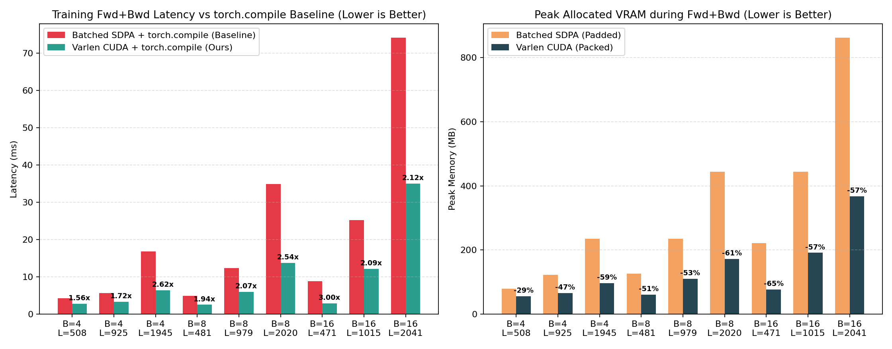

# Varlen-Attention (`varlen_transformer`)

High-performance **Variable-Length FlashAttention**, **Fused RoPE**, and **Adaptive Split-K Flash Decoding** CUDA/CuTe library for **NVIDIA Turing (`SM75` — Tesla T4 / RTX 20 series)**, with native **PyTorch Autograd** and **`torch.compile` (TorchInductor)** support.

---

## Motivation

This project was built to help **students, researchers, and self-learners** train and run Transformer models efficiently on accessible **Turing (`SM75`)** GPUs such as **Google Colab / Kaggle Tesla T4** and **RTX 20 series** cards:

- **PyTorch SDPA is a black box for `torch.compile`:** `F.scaled_dot_product_attention` cannot be flexibly fused with surrounding operations under TorchInductor, and frequently falls back to the slow `MATH` backend when handling variable-length padding masks.
- **Modern Triton backends target Ampere+ (`SM80+`):** Triton-based attention kernels (e.g., FlashAttention-Triton, FlexAttention) are primarily tuned for A100/H100 and underperform or hit shared-memory/register limits on Turing `SM75`.
- **Legacy SM75 libraries are unmaintained:** Older libraries with SM75 support such as **FlashAttention-1 (`v1.0.9`)** are no longer updated and require downgrading Python, PyTorch, CUDA, and the C++ compiler just to build.

`varlen_transformer` bridges this gap with a clean, ready-to-use package (including pre-built `.whl` support) that runs on modern PyTorch and `torch.compile` out of the box.

---

## Benchmarks (NVIDIA Tesla T4 — `SM75`)

All benchmarks below were measured on **NVIDIA Tesla T4 (15 GB, `SM75`)** with **PyTorch `2.14.1+cu130`**, **CUDA `13.0`**, and `head_dim = 64`, FP16, `RoPE = True`.

- **Baseline:** `BatchedFlashGQABaselineSpeed` compiled with `torch.compile(backend="inductor")`, using **FP16 additive padding masks (`0.0` / `-inf`)** aligned to multiples of 8 (`stride(-1) = 1`, `stride(-2) % 8 == 0`) to explicitly activate **`SDPBackend.EFFICIENT_ATTENTION`** (xFormers CUTLASS) on T4 (`choice=2` verified).
- **Ours:** `VarlenFlashGQA` / `varlen_flash_decode` compiled with `torch.compile(backend="inductor")` via registered `FakeTensor` kernels.

### 1. Training Benchmark (`Fwd+Bwd`, `H_q=16, H_kv=4, D=64, causal=True`)



Representative `skewed` & `uniform` results from [Benchmark/demo_varlen_transformer.ipynb](Benchmark/demo_varlen_transformer.ipynb):

| Dist | B | MaxLen | Pad% | Batched+Comp (ms) | Varlen+Comp (ms) | Comp Speedup | TFLOP/s | Peak VRAM (Ours / Base) |
| --- | -- | ------ | ----- | ----------------- | ---------------- | ------------ | ------- | ----------------------- |
| skewed | 4 | 508 | 39.8% | 4.277 | 2.738 | **1.56x** | 1.31 | 56.0 / 78.8 MB (-29%) |
| skewed | 4 | 1945 | 59.9% | 16.763 | 6.388 | **2.62x** | 4.83 | 97.0 / 234.9 MB (-59%) |
| skewed | 8 | 2020 | 59.2% | 34.894 | 13.756 | **2.54x** | 4.86 | 172.4 / 444.4 MB (-61%) |
| skewed | 16 | 471 | 72.1% | 8.813 | 2.937 | **3.00x** | 1.33 | 77.1 / 221.6 MB (-65%) |
| skewed | 16 | 2041 | 52.0% | 74.173 | 35.003 | **2.12x** | 5.16 | 367.8 / 862.7 MB (-57%) |
| uniform | 8 | 1381 | 41.3% | 22.011 | 12.675 | **1.74x** | 4.02 | 169.8 / 313.8 MB (-46%) |

---

### 2. Inference Benchmark (`H_q=32, H_kv=8, D=64`)


#### Part A: Cold-L2 Decode Attention (`L_q = 1`) vs `SDPBackend.EFFICIENT_ATTENTION` + `torch.compile`

| Dist | B | MaxK | TotalLk | Batched+Comp (ms) | Auto+Comp (ms) | Comp Speedup | Eager Speedup | BW (GB/s) | Tok/s |
| --- | -- | ---- | ------- | ----------------- | -------------- | ------------ | ------------- | --------- | ------- |
| skewed | 1 | 3712 | 3712 | 0.957 | 0.273 | **3.51x** | 7.82x | 27.9 | 3,667 |
| skewed | 8 | 996 | 5286 | 1.164 | 0.219 | **5.31x** | 7.95x | 49.7 | 36,507 |
| skewed | 8 | 3923 | 11989 | 2.059 | 0.270 | **7.62x** | 8.96x | 91.1 | 29,593 |
| skewed | 32 | 126 | 1546 | 0.280 | 0.082 | **3.41x** | 6.61x | 41.8 | 389,864 |
| skewed | 32 | 1018 | 15593 | 2.040 | 0.273 | **7.47x** | 8.78x | 117.9 | 117,165 |
| skewed | 32 | 2034 | 25431 | 3.795 | 0.412 | **9.22x** | 6.39x | 127.2 | 77,736 |
| skewed | 32 | 4095 | 50267 | 7.711 | 1.112 | **6.94x** | 5.63x | 92.8 | 28,784 |

#### Part B: End-to-End Prefill (TTFT) + 32-Step Generation (TPOT) + Peak VRAM

| B | MaxL | Pad% | Base TTFT (ms) | Ours TTFT (ms) | Base TPOT (ms) | Ours TPOT (ms) | Base E2E (ms) | Ours E2E (ms) | E2E VRAM (Ours / Base) |
| -- | ---- | ----- | -------------- | -------------- | -------------- | -------------- | ------------- | ------------- | ---------------------- |
| 4 | 1988 | 41.3% | 16.14 | 8.86 (1.82x) | 1.378 | 0.688 (**2.00x**) | 60.53 | 25.08 (**2.41x**) | 123.9 / 264.6 MB (**-53%**) |
| 16 | 998 | 56.6% | 21.19 | 11.33 (1.87x) | 2.295 | 0.858 (**2.68x**) | 95.01 | 32.42 (**2.93x**) | 202.9 / 472.2 MB (**-57%**) |
| 32 | 254 | 60.4% | 10.59 | 2.76 (3.83x) | 1.369 | 0.686 (**1.99x**) | 53.54 | 22.68 (**2.36x**) | 119.5 / 266.3 MB (**-55%**) |
| 32 | 511 | 65.4% | 19.93 | 9.27 (2.15x) | 2.445 | 0.699 (**3.50x**) | 97.57 | 29.39 (**3.32x**) | 172.8 / 482.4 MB (**-64%**) |
| 64 | 255 | 65.5% | 19.44 | 8.20 (2.37x) | 2.625 | 0.731 (**3.59x**) | 102.12 | 31.40 (**3.25x**) | 172.3 / 482.5 MB (**-64%**) |
| 64 | 510 | 65.6% | 40.39 | 16.17 (2.50x) | 4.690 | 1.129 (**4.15x**) | 189.92 | 50.60 (**3.75x**) | 292.3 / 914.5 MB (**-68%**) |
| 96 | 255 | 62.1% | 28.25 | 12.88 (2.19x) | 3.824 | 1.077 (**3.55x**) | 151.46 | 46.93 (**3.23x**) | 249.9 / 698.6 MB (**-64%**) |

---

## Installation

### Requirements
- **GPU:** NVIDIA Turing (`SM75`, e.g., Tesla T4, RTX 2060/2070/2080) or compatible CUDA GPU
- **CUDA Toolkit** + **PyTorch >= 2.0**

### Option 1: Install Pre-built Wheel (Fastest)
If your environment matches the pre-built wheel in `wheels/`:

```bash
pip install --no-deps wheels/varlen_transformer-1.0.0-py3-none-any.whl
```

### Option 2: Build from Source
`setup.py` automatically detects `third_party/cutlass` (or `CUTLASS_PATH`) and shallow-clones NVIDIA CUTLASS if missing:

```bash
pip install -r requirements.txt
pip install --no-deps --no-build-isolation -e .
```

To build a reusable `.whl` in `wheels/`:

```bash
python -m pip wheel --no-deps --no-build-isolation -w wheels .
```

---

## Quick Start

### 1. Packed Varlen Training (`VarlenFlashGQA` + `torch.compile`)

```python
import torch
from varlen_transformer import RotaryPositionalEmbedding, VarlenFlashGQA

device = "cuda"
embed_dim, num_heads_q, num_heads_kv, head_dim = 1024, 16, 4, 64

rope = RotaryPositionalEmbedding(head_dim, max_seq_len=2048, device=device)
model = VarlenFlashGQA(embed_dim, num_heads_q, num_heads_kv, rope=rope).to(
    device=device, dtype=torch.float16
)
compiled_model = torch.compile(model, backend="inductor")

# Packed batch of 3 sequences: lengths [128, 512, 65] -> Total_Lq = 705
cu_seqlens = torch.tensor([0, 128, 640, 705], dtype=torch.int32, device=device)
x = torch.randn((705, embed_dim), device=device, dtype=torch.float16, requires_grad=True)

out = compiled_model(
    x,
    cu_seqlens_q=cu_seqlens,
    max_seqlen_q=512,
    max_seqlen_k=512,
    is_causal=True,
)
out.sum().backward()
```

### 2. Varlen Prefill + Autoregressive Decode (`VarlenKVCache`)

```python
with torch.no_grad():
    prefill_out, kv_cache = model(
        x,
        cu_seqlens_q=cu_seqlens,
        max_seqlen_q=512,
        max_seqlen_k=512,
        is_causal=True,
        use_cache=True,
    )

    # Decode step (Lq = 1 token per sequence in batch B = 3)
    x_next = torch.randn((3, embed_dim), device=device, dtype=torch.float16)
    decode_out, kv_cache = model(x_next, kv_cache=kv_cache, use_cache=True, decode=True)
```

---

## Running Tests & Benchmarks

```bash
# 1. Numerical correctness (Fwd, Bwd, Decode, E2E GQA, VarlenKVCache, torch.compile)
python tests/test_correctness.py

# 2. Training (Fwd & Fwd+Bwd) speed & VRAM vs torch.compile Baseline
python tests/bench_training.py --save-plot assets/training_benchmark.png

# 3. Inference (Cold-L2 Decode L=1 & E2E Prefill+Generation) vs torch.compile Baseline
python tests/bench_inference.py --gen-steps 32 --save-plot assets/inference_benchmark.png
```

For a complete Colab/Kaggle walkthrough (build, wheel packaging, verification, benchmarks, and `ncu` profiling), see [Benchmark/demo_varlen_transformer.ipynb](Benchmark/demo_varlen_transformer.ipynb).

---

## Project Structure

```text
Varlen-Attention/
├── include/                         # CUDA/CuTe headers (mha_common.cuh, mha_ops.cuh)
├── src/                             # CUDA kernels & PyTorch bindings (fwd, bwd, decode)
├── varlen_transformer/              # Python package (ops.py, model.py)
├── tests/                           # Correctness & benchmark suites
├── Benchmark/                       # End-to-end demo notebook
├── assets/                          # Benchmark plots
├── wheels/                          # Pre-built wheel (.whl) directory
├── setup.py
├── requirements.txt
└── LICENSE                          # Apache License 2.0
```

---

## License

This project is licensed under the **Apache License 2.0**. See [LICENSE](LICENSE) for details.
