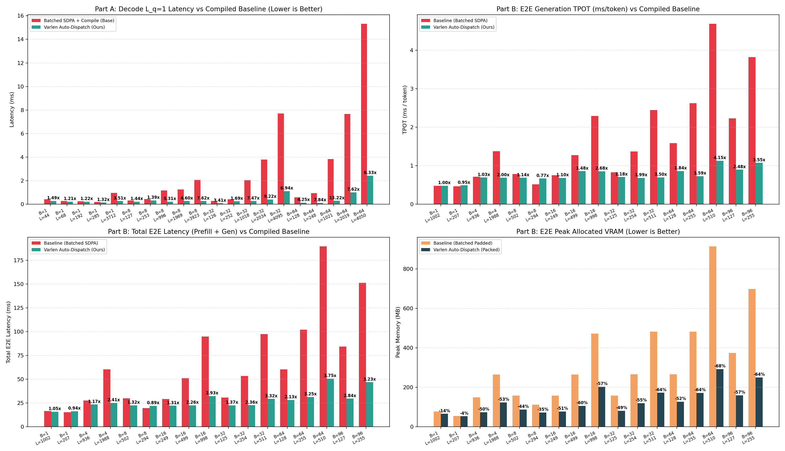

<h1 align="center">
  
</h1>

<p align="center"><em>Variable-length FlashAttention, Fused RoPE, and Adaptive Split-K Flash Decoding for NVIDIA Turing (SM75).</em></p>

<p align="center">
  
  
  
  
</p>

<p align="center"><em>Built with the tools and technologies:</em></p>

<p align="center">
  
  
  
  
</p>

<div align="center">

| **3.00x** | **9.22x** | **4.15x** | **-68%** |
|:---:|:---:|:---:|:---:|
| faster training Fwd+Bwd | faster L_q=1 decode | faster E2E TPOT | peak VRAM saved |

</div>

<details>
<summary><b>Table of Contents</b></summary>

- [Overview](#overview)
- [Benchmarks](#benchmarks)
- [Requirements](#requirements)
- [Getting started](#getting-started)
- [Demo](#demo)
- [Project structure](#project-structure)
- [License](#license)

</details>

---

## Overview

`Varlen-Attention` (`varlen_transformer`) provides packed variable-length attention, fused rotary embeddings, and adaptive decode kernels engineered for NVIDIA Turing (`SM75`) GPUs with `PyTorch` Autograd and `torch.compile` support. On an NVIDIA Tesla T4 (`SM75`), it achieves up to **3.00x** faster training with **65%** lower peak VRAM, **9.22x** faster `L_q = 1` decode, and **4.15x** faster end-to-end token generation (`TPOT`) than compiled `SDPBackend.EFFICIENT_ATTENTION`.

### Why Varlen-Attention?

This project was built to help students, researchers, and self-learners train and run Transformer models efficiently on accessible Turing (`SM75`) GPUs such as Google Colab / Kaggle Tesla T4 and RTX 20 series cards. The core features include:

- 🎯 **Built for Turing (`SM75`):** Targets T4 and RTX 20 series GPUs, where `Triton` kernels focus on Ampere (`SM80+`) and legacy `FlashAttention-1` requires downgrading `PyTorch` and C++ compilers.
- 📦 **Zero-Padding Varlen Layout:** Operates directly on packed `(H, Total_L, 64)` tensors, cutting peak VRAM by up to **68%** (`292.3 MB` vs `914.5 MB` at `B = 64, L = 510`).
- ⚡ **`torch.compile` Native:** Exposes `TORCH_LIBRARY` operators and `FakeTensor` registrations so `TorchInductor` compiles models without graph breaks, unlike opaque `F.scaled_dot_product_attention`.
- 🚀 **Prebuilt Distribution:** Ships a ready-to-install `.whl` in `wheels/` for modern `PyTorch` and C++20 environments.

| Solution | Turing (`SM75`) Speed | `torch.compile` Fusion | Modern PyTorch & C++20 | Zero-Padding Varlen |
| :--- | :---: | :---: | :---: | :---: |
| **PyTorch SDPA** (`F.scaled_dot_product_attention`) | Falls back to slow `MATH` with `bool` masks | Black box (no custom fusion) | Yes | No (requires padding) |
| **Triton / FlexAttention** | Tuned for Ampere (`A100 / SM80+`) | Yes | Yes | Partial |
| **FlashAttention-1 (`v1.0.9`)** | Fast | No | Unmaintained (requires PyTorch & C++ downgrades) | Yes |
| **Varlen-Attention (`Ours`)** | **Optimized for `SM75`** | **Full `FakeTensor` + Inductor** | **Yes (prebuilt `.whl` included)** | **Yes (packed layout)** |

---

## Benchmarks

> [!NOTE]
> **Setup:** Measured on **NVIDIA Tesla T4 (15 GB, `SM75`)** with **PyTorch `2.14.1+cu130`**, **CUDA `13.0`**, Driver `580.82.07`, `head_dim = 64`, FP16, `RoPE = True`, median latency over `rep = 50` (`warmup = 15`; `clear_l2 = True` for inference).
> **Fair Baseline:** `BatchedFlashGQABaselineSpeed` compiled with `torch.compile(backend="inductor")`, using **FP16 additive padding masks (`0.0` / `-inf`)** aligned to multiples of 8 (`stride(-1) = 1`, `stride(-2) % 8 == 0`) to explicitly activate **`SDPBackend.EFFICIENT_ATTENTION`** (xFormers CUTLASS) on T4 (`choice=2` verified).

### Training (`Fwd+Bwd`, `H_q = 16, H_kv = 4, D = 64, causal = True`)

| Dist | `B` | `MaxLen` | Pad (%) | Batched+Comp (ms) ↓ | Varlen+Comp (ms) ↓ | Speedup | TFLOP/s ↑ | VRAM (Ours / Base, MB) ↓ |
| :--- | :---: | :---: | :---: | :---: | :---: | :---: | :---: | :---: |
| skewed | 4 | 508 | 39.8% | 4.277 | **2.738** | **1.56x** | 1.31 | **56.0** / 78.8 (-29%) |
| skewed | 4 | 1945 | 59.9% | 16.763 | **6.388** | **2.62x** | 4.83 | **97.0** / 234.9 (-59%) |
| skewed | 8 | 2020 | 59.2% | 34.894 | **13.756** | **2.54x** | 4.86 | **172.4** / 444.4 (-61%) |
| skewed | 16 | 471 | 72.1% | 8.813 | **2.937** | **3.00x** | 1.33 | **77.1** / 221.6 (-65%) |
| skewed | 16 | 2041 | 52.0% | 74.173 | **35.003** | **2.12x** | **5.16** | **367.8** / 862.7 (-57%) |
| uniform | 8 | 1381 | 41.3% | 22.011 | **12.675** | **1.74x** | 4.02 | **169.8** / 313.8 (-46%) |

<p align="center">
  
</p>

```bash
python tests/bench_training.py --batch-sizes 4 8 16 --max-lens 512 1024 2048 --distributions skewed uniform --save-plot assets/training_benchmark.png
```

### Inference — Cold-L2 Decode Attention (`L_q = 1`, `H_q = 32, H_kv = 8, D = 64`)

| Dist | `B` | `MaxK` | `TotalLk` | Batched+Comp (ms) ↓ | Ours+Comp (ms) ↓ | Comp Speedup | Eager Speedup | BW (GB/s) ↑ | Throughput (tok/s) ↑ |
| :--- | :---: | :---: | :---: | :---: | :---: | :---: | :---: | :---: | :---: |
| skewed | 1 | 3712 | 3712 | 0.957 | **0.273** | **3.51x** | 7.82x | 27.9 | 3,667 |
| skewed | 8 | 996 | 5286 | 1.164 | **0.219** | **5.31x** | 7.95x | 49.7 | 36,507 |
| skewed | 8 | 3923 | 11989 | 2.059 | **0.270** | **7.62x** | **8.96x** | 91.1 | 29,593 |
| skewed | 32 | 126 | 1546 | 0.280 | **0.082** | **3.41x** | 6.61x | 41.8 | **389,864** |
| skewed | 32 | 1018 | 15593 | 2.040 | **0.273** | **7.47x** | 8.78x | 117.9 | 117,165 |
| skewed | 32 | 2034 | 25431 | 3.795 | **0.412** | **9.22x** | 6.39x | **127.2** | 77,736 |
| skewed | 32 | 4095 | 50267 | 7.711 | **1.112** | **6.94x** | 5.63x | 92.8 | 28,784 |

### Inference — End-to-End Prefill (`TTFT`) + 32-Step Generation (`TPOT`) + Peak VRAM

| `B` | `MaxL` | Pad (%) | Base TTFT (ms) ↓ | Ours TTFT (ms) ↓ | Base TPOT (ms) ↓ | Ours TPOT (ms) ↓ | Base E2E (ms) ↓ | Ours E2E (ms) ↓ | E2E VRAM (Ours / Base, MB) ↓ |
| :---: | :---: | :---: | :---: | :---: | :---: | :---: | :---: | :---: | :---: |
| 4 | 1988 | 41.3% | 16.14 | **8.86** (1.82x) | 1.378 | **0.688** (2.00x) | 60.53 | **25.08** (2.41x) | **123.9** / 264.6 (-53%) |
| 16 | 998 | 56.6% | 21.19 | **11.33** (1.87x) | 2.295 | **0.858** (2.68x) | 95.01 | **32.42** (2.93x) | **202.9** / 472.2 (-57%) |
| 32 | 254 | 60.4% | 10.59 | **2.76** (3.83x) | 1.369 | **0.686** (1.99x) | 53.54 | **22.68** (2.36x) | **119.5** / 266.3 (-55%) |
| 32 | 511 | 65.4% | 19.93 | **9.27** (2.15x) | 2.445 | **0.699** (3.50x) | 97.57 | **29.39** (3.32x) | **172.8** / 482.4 (-64%) |
| 64 | 255 | 65.5% | 19.44 | **8.20** (2.37x) | 2.625 | **0.731** (3.59x) | 102.12 | **31.40** (3.25x) | **172.3** / 482.5 (-64%) |
| 64 | 510 | 65.6% | 40.39 | **16.17** (2.50x) | 4.690 | **1.129** (**4.15x**) | 189.92 | **50.60** (**3.75x**) | **292.3** / 914.5 (**-68%**) |
| 96 | 255 | 62.1% | 28.25 | **12.88** (2.19x) | 3.824 | **1.077** (3.55x) | 151.46 | **46.93** (3.23x) | **249.9** / 698.6 (-64%) |

<p align="center">
  
</p>

```bash
python tests/bench_inference.py --batch-sizes 1 8 32 64 --max-lens 128 256 1024 2048 4096 --num-heads-q 32 --num-heads-kv 8 --distributions skewed uniform --gen-steps 32 --save-plot assets/inference_benchmark.png
```

---

## Requirements

| Component | Tested | Minimum |
|---|---|---|
| GPU | NVIDIA Tesla T4 (`SM75`) | Turing (`SM75`) or newer CUDA GPU |
| CUDA / Driver | CUDA `13.0` / Driver `580.82.07` | CUDA `11.8` |
| PyTorch | `2.14.1+cu130` | `2.0` |
| Python | `3.13` | `3.10` |
| C++ Compiler | C++20 (`g++` / `nvcc`) | C++20 (`PyTorch >= 2.1`) |

---

## Getting started

### Prerequisites

Install `PyTorch` with CUDA support along with `ninja`, `wheel`, and `setuptools`.

### Installation

> [!TIP]
> On Google Colab or compatible Python `3.13` / CUDA `13.0` environments, install directly from `wheels/` without waiting for NVCC compilation.

```bash
# Option 1: Install prebuilt wheel
pip install --no-deps wheels/varlen_transformer-1.0.0-py3-none-any.whl
```

To build from source (`setup.py` automatically detects `third_party/cutlass` or `CUTLASS_PATH` and shallow-clones NVIDIA CUTLASS if missing):

```bash
# Option 2: Build from source
pip install -r requirements.txt
pip install --no-deps --no-build-isolation -e .

# Optional: Package a reusable wheel into wheels/
python -m pip wheel --no-deps --no-build-isolation -w wheels .
```

### Usage

```python
import torch
from varlen_transformer import RotaryPositionalEmbedding, VarlenFlashGQA

device = "cuda"
embed_dim, num_heads_q, num_heads_kv, head_dim = 1024, 16, 4, 64

rope = RotaryPositionalEmbedding(head_dim, max_seq_len=2048, device=device)
model = VarlenFlashGQA(embed_dim, num_heads_q, num_heads_kv, rope=rope).to(
    device=device, dtype=torch.float16
)
compiled_model = torch.compile(model, backend="inductor")

# Packed batch of 3 sequences: lengths [128, 512, 65] -> Total_Lq = 705
cu_seqlens = torch.tensor([0, 128, 640, 705], dtype=torch.int32, device=device)
x = torch.randn((705, embed_dim), device=device, dtype=torch.float16, requires_grad=True)

out = compiled_model(
    x,
    cu_seqlens_q=cu_seqlens,
    max_seqlen_q=512,
    max_seqlen_k=512,
    is_causal=True,
)
out.sum().backward()
```

```python
with torch.no_grad():
    prefill_out, kv_cache = model(
        x,
        cu_seqlens_q=cu_seqlens,
        max_seqlen_q=512,
        max_seqlen_k=512,
        is_causal=True,
        use_cache=True,
    )

    # Decode step (Lq = 1 token per sequence in batch B = 3)
    x_next = torch.randn((3, embed_dim), device=device, dtype=torch.float16)
    decode_out, kv_cache = model(x_next, kv_cache=kv_cache, use_cache=True, decode=True)
```

---

## Demo

Run the full correctness suite (`mha_fwd`, `mha_bwd`, `mha_decode`, `VarlenKVCache`, and `torch.compile`) or open the interactive Colab/Kaggle notebook [benchmark/demo_varlen_transformer.ipynb](benchmark/demo_varlen_transformer.ipynb):

```bash
python tests/test_correctness.py
```

---

## Project structure

```text
Varlen-Attention/
├── include/                  # CUDA/CuTe headers (mha_common.cuh, mha_ops.cuh)
├── src/                      # CUDA kernels & PyTorch bindings (fwd, bwd, decode)
├── varlen_transformer/       # Python package (ops.py, model.py)
├── tests/                    # Correctness & benchmark suites
├── benchmark/                # End-to-end demo notebook
├── assets/                   # Benchmark plots
├── docs/images/              # Animated SVG title
├── wheels/                   # Pre-built wheel (.whl) directory
├── setup.py
├── requirements.txt
└── LICENSE                   # Apache License 2.0
```

---

## License

This project is licensed under the Apache License 2.0. See [LICENSE](LICENSE) for details.
